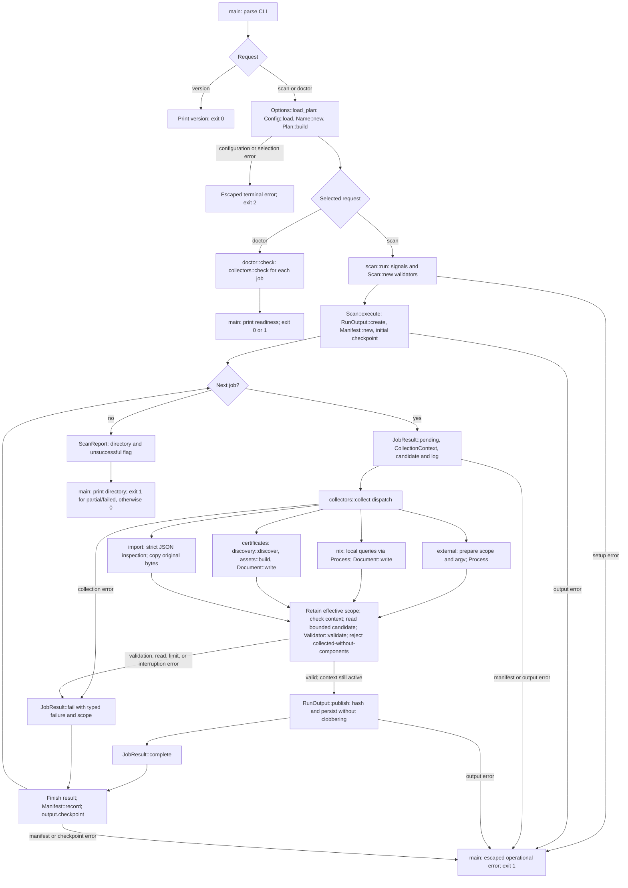
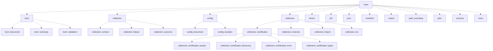

# Implementation Plan

Bommer uses Rust for orchestration, Nix/devenv for the development environment,
just for recipes, and nFPM for native packages.
Application identities, scopes, and enabled collectors belong in
configuration, not compiled application-specific code.

## Code Organization

Start in `src/main.rs`: CLI definitions describe the available requests,
`main` shows dispatch and terminal output, and `CliError` defines
the process exit policy. CLI options are translated into domain selections here;
production modules never import CLI types.

Each module owns a concrete responsibility:

| Module | Responsibility |
| --- | --- |
| `main` | Parse CLI requests, load configuration, build selections, compose scan/doctor, print escaped terminal errors, and choose exit codes. |
| `config` | Decode and validate YAML into enabled jobs, application names, output directory, and timeout. |
| `config::document` | Own the raw deserialization structs, defaults, null handling, and unknown-field rejection. |
| `config::duration` | Parse positive Go-style durations without depending on configuration orchestration. |
| `job` | Own validated names, inventory kinds, scopes, targets, backend options, job compatibility checks, and artifact stems. |
| `plan` | Select jobs and reject unknown applications, empty selections, and name collisions. |
| `scan` | Execute a scan: collect, validate, publish, and record each job. |
| `doctor` | Check selected collectors for readiness without executing collections. |
| `collection` | Namespace for execution and result contracts; no orchestration or re-export facade. |
| `collection::context` | Own per-job deadlines, shared cancellation, and typed interruption checks. |
| `collection::outcome` | Own collection outcomes, statuses, coverage, diagnostics, and effective execution scope. |
| `collection::failure` | Own stable structured failure categories and optional process/limit details. |
| `collectors` | Dispatch collection and preflight; wrap backend errors and classify typed sources into structured failures. |
| `collectors::external` | Prepare hbom, Syft, and command argv, resolve Git exclusions, preserve effective scope, and run bounded commands. |
| `collectors::nix` | Resolve explicit local closure roots, query local Nix metadata, and emit store-reference documents and evidence. |
| `collectors::certificates` | Compose option checks, discovery, asset construction, serialization, and certificate outcomes. |
| `collectors::certificates::discovery` | Resolve declared paths and targets; perform bounded descriptor-relative no-follow traversal, PEM/DER observation, deduplication, and diagnostics. |
| `collectors::certificates::assets` | Convert observations into certificate and algorithm components, optional identities, and source evidence. |
| `collectors::certificates::error` | Own typed certificate option, target, interruption, and I/O errors. |
| `collectors::certificates::types` | Own shared `Observation`, `Discovery`, and `Assets` contracts, independent of the discovery/build implementations. |
| `collectors::import` | Inspect a trusted existing CBOM, reject known private material, and preserve original bytes and source evidence. |
| `bom` | Namespace for native writing, validation, and embedded schema support. |
| `bom::document` | Own and serialize the native CycloneDX document representation. |
| `bom::validation` | Own validators, validation errors, and document summaries; enforce offline schemas and external inventory requirements. |
| `bom::schemas` | Own compiled embedded schemas, the reference registry, component counting, and denial of external retrieval. |
| `manifest` | Own manifest v2, job-result transitions, artifact records, timestamps, and unsuccessful-result aggregation; no filesystem persistence. |
| `output` | Own the output lock and private run directory, temporary candidates, logs, hashing/publication, and atomic manifest checkpoints. |
| `process` | Own validated command specifications, executable lookup, bounded subprocess I/O, process-group cleanup, deadlines, and cancellation. No internal module dependencies. |
| `json` | Decode bounded JSON while rejecting duplicate keys. |
| `path_encoding` | Encode filesystem paths losslessly for JSON, including reserved-prefix escaping and non-UTF-8 byte tags. |

Types and their inherent/trait implementations stay in their owner file and
module. Shared contracts are imported from explicit owners with `crate::...`
paths, not from sibling implementation modules or through `use super` imports.
Composition and cohesive namespaces take precedence over mechanical splitting,
getter/setter wrappers, or a catch-all shared model.

### Current Call Flow

`Options::load_plan` loads configuration and translates CLI selectors into domain
values. `main` passes only `&plan.jobs`, the output root, and timeout to
`scan::run`; scan execution has no `config` or `plan` dependency. `scan::run`
registers SIGINT/SIGTERM cancellation and constructs a `Scan` with compiled
validators. `Scan::execute` accepts explicit cancellation for fixture tests.

The following is execution flow, not a module dependency graph. Collection errors
become failed job results and normally allow later jobs to run; scan setup,
output, and manifest errors propagate as operational errors.

Only `main` prints terminal results and chooses exit codes. Usage, configuration,
invalid application names, unknown applications, empty selections, and artifact
collisions exit `2`. Readiness failures, partial/failed jobs, and operational scan
errors exit `1`; successful collection/no-findings/readiness exits `0`.

### Module Containment

Dashed links below mean **declares/contains**, not **depends on**. `collection` and
`bom` are namespace-only parents. Containment is deliberately separate from the
production dependency graph.

### Direct Dependencies

Every solid arrow below means **directly references/imports**, excluding test-only
code, external crates, self-references, and module declarations. Edges target the
actual owner, not every namespace traversed in a qualified path. This is the full
direct graph, not a transitive reduction; runtime access to inferred return-value
fields does not add a named module reference. Nodes without outgoing arrows are
internal dependency leaves.

```mermaid
flowchart TD
    main --> config
    main --> plan
    main --> scan
    main --> doctor
    main --> job
    config --> cd["config::document"]
    config --> ct["config::duration"]
    config --> job
    config --> process
    plan --> config
    plan --> job
    job --> path_encoding
    job --> process
    scan --> bv["bom::validation"]
    scan --> cc["collection::context"]
    scan --> cf["collection::failure"]
    scan --> co["collection::outcome"]
    scan --> collectors
    scan --> job
    scan --> manifest
    scan --> output
    doctor --> collectors
    doctor --> job
    manifest --> cf
    manifest --> co
    manifest --> job
    output --> job
    output --> manifest
    co --> path_encoding
    bv --> bs["bom::schemas"]
    bv --> json
    collectors --> certificates["collectors::certificates"]
    collectors --> external["collectors::external"]
    collectors --> import["collectors::import"]
    collectors --> nix["collectors::nix"]
    collectors --> ce["collectors::certificates::error"]
    collectors --> cc
    collectors --> cf
    collectors --> co
    collectors --> job
    collectors --> process
    certificates --> ca["collectors::certificates::assets"]
    certificates --> cdisc["collectors::certificates::discovery"]
    certificates --> ce
    certificates --> cc
    certificates --> co
    certificates --> job
    certificates --> path_encoding
    ca --> document["bom::document"]
    ca --> cc
    ca --> ce
    ca --> cty["collectors::certificates::types"]
    ca --> path_encoding
    cdisc --> cc
    cdisc --> co
    cdisc --> ce
    cdisc --> cty
    cdisc --> job
    ce --> cc
    cty --> document
    cty --> co
    external --> cc
    external --> co
    external --> job
    external --> path_encoding
    external --> process
    import --> cc
    import --> co
    import --> job
    import --> json
    import --> path_encoding
    nix --> document
    nix --> cc
    nix --> co
    nix --> job
    nix --> path_encoding
    nix --> process
    bom["bom (namespace only)"]
    collection["collection (namespace only)"]
```

Keep dependencies one-way. Readiness checks do not belong in scan execution,
terminal formatting does not belong in collectors, and persistence must not
decide CLI exit codes. `process` is independent of application modules;
`collection` contracts do not depend on collectors, process execution, or
orchestration. `manifest` must not depend on `output`; `scan` must not depend on
`config` or `plan`; `doctor` must not depend on `scan`, `output`, or `manifest`.

Owner-local inline unit tests protect behavior. `tests/cli.rs` exercises the
binary as a black box. `tests/architecture.rs` checks the cross-repository module
graph for cycles, ancestor dependencies, misplaced type implementations, and
forbidden layer reachability, including transitive paths. It excludes test-only
code and resolves module/item imports, aliases, and re-exports; it is not rustc
name resolution and does not resolve macro bodies/expansions, `include!`, method
dispatch, or inferred types. Non-test cfg branches are inspected conservatively.

## Baseline

Initial target: x86_64 Linux. Intended integration matrix: Ubuntu 26.04 LTS,
Debian 13 stable, Rocky Linux 10 latest supported minor, and NixOS 26.05 stable.
These are targets, not a claim that integration tests already pass. Pin exact
images before release; update deliberately. NixOS has no LTS channel.

## Progress

The Rust implementation now backs the default build. The capabilities below
describe the implemented pipeline, not a claim of full parity with the reference
or completed live integration verification. See
the [style guide](STYLE.md).

- Implemented: strict configuration parsing, application targets, collector
  selection, executable/directory preflight, process-group timeouts and
  cancellation, output locking, private artifacts, hashes, run manifests.
- Implemented: named `host.inventories` and `applications[].inventories` lists
  of `{name, kind, collector}`, explicitly enabled with `enabled: true`, alongside
  existing host HBOM/SBOM and application SBOM/CBOM configuration.
- Implemented adapters: Syft SBOM and cdxgen hbom. These still need live-host
  integration testing and version pinning.
- Implemented Syft scope controls: explicit exclusions, opt-in Git ignore
  evaluation, application name/version metadata, and effective exclusions in
  manifests. Integration fixtures verify negation and literal path escaping.
- Implemented escape hatch: explicitly configured external command collectors
  producing CycloneDX JSON on stdout, including application CBOM and Nix-aware
  collectors. No automatic backend downloads or shell expansion.
- Implemented: offline CycloneDX 1.6/1.7 validation using embedded schemas and
  references. Manifest v2 records `json-schema-offline`, scope, inventory,
  findings, coverage, available collector versions, diagnostics, and evidence.
- Implemented: additive manifest v2 `failure` objects with stable `kind` and
  applicable `exitCode`, `stream`, and `limit` fields; human-readable `error`
  remains, but its wording is not a test or consumer interface. Collectors classify
  typed process errors into `collection::failure::Failure` before persistence.
- Implemented: byte-preserving JSON path representation through `path_encoding::path_text`.
  Ordinary UTF-8 paths remain unchanged; reserved-prefix literals are escaped as
  `bommer:utf8:<literal>`, and invalid UTF-8 paths use `bommer:unix-bytes:<hex>`.
  See the path contract in `path_encoding::path_text` documentation.
- Implemented: 64 MiB external BOM and 1 MiB stderr-log bounds. Nix query stderr
  is limited to 16 KiB; overflow fails rather than using the Go reference's
  truncation behavior. This is an intentional behavioral difference, not parity.
- Implemented native Nix SBOM: explicitly configured existing local `/nix/store`
  closures, host `nix.roots`, and application `nix-closure` targets. Queries are
  offline/local only, with no evaluation, builds, downloads, or whole-store
  discovery. NAR hash/size are properties, not ordinary file hashes. Rust tests
  use fake Nix executables and current/legacy metadata fixtures; live version
  compatibility remains to be verified independently.
- Implemented native certificate CBOM: explicit PEM/DER X.509 paths, no-follow
  traversal for all path components, 4 MiB default/64 MiB maximum file size,
  100,000-entry/depth-128 bounds, deduplication, and partial-result diagnostics.
  Identity export is opt-in; private-key PEM blocks are not decoded or parsed.
  Observations do not evaluate trust or prove application crypto usage.
- Implemented CBOM-only import: trusted existing regular files up to 64 MiB,
  original bytes/source hash preserved, known private material rejected. Coverage
  and application association remain producer/configuration-declared, unverified.
  Import and BOM validation share strict decoding in independent root `json.rs`;
  fixtures exercise deep documents and typed depth-limit rejection.
- Implemented result statuses: `collected`, `partial`, `no-findings`, and
  `failed`. Partial artifacts survive but partial/failure exits `1`. Native
  backends alone can assert no-findings; empty external output still fails.
- Added: Rust behavioral and architecture tests, devenv shell, Rust flake package,
  NixOS module, nFPM package definitions,
  opt-in systemd timer.
- Added: `just schema-test`, `just integration-test`, and `just architecture-test`
  using Cargo filters for inline owner-module unit tests in the single binary,
  plus the `cli` and `architecture` integration targets under `tests/`.
  Native fixtures use fake collectors/Nix, require no live Nix, and never select
  a closure root automatically. The removed Go prototype used a
  `BOMMER_TEST_NIX_ROOT` live-test gate; that variable does not enable a Rust live test.
- Deferred proof of concept, NOT implemented: source-code cryptography scanner
  integration. The `command` and `import` boundaries are not source scanners.
- Remaining: external collector version/diagnostic capture and incomplete
  discovery reporting; broader Nix version/OS verification; dependency bundling
  with license review; installed-package lifecycle and broader VM integration tests.

## Verification Scope

`just check` checks rustfmt, strict Clippy, inline owner-module unit tests,
cross-repository architecture checks (`tests/architecture.rs`), and black-box CLI
tests (`tests/cli.rs`) using the committed Cargo lockfile. `just schema-test`
filters `bom::` and `json::tests::` unit tests; `just integration-test` filters
owner-local fixture tests and runs the CLI target; `just architecture-test` runs
`cargo test --locked --test architecture`, including checker fixtures.
The flake package runs the same tests in
its check phase. `just build` writes `dist/bommer` for the unchanged nFPM recipes.
These checks are not Go's race detector. `just build` explicitly uses the static
musl target for native packages; the Nix package uses its native GNU target.
`just portable-test` runs the same tests against musl. Passing builds does not guarantee integration on the
target distributions; installed binaries still require distro-specific testing.

[`cyclonedx-bom` 0.9](https://crates.io/crates/cyclonedx-bom/0.9.0) was evaluated
and supports 1.6/1.7 cryptographic assets. The implementation keeps official offline
schemas plus a small native writer to preserve exact imported bytes and explicit
empty `dependsOn` versus omission, rather than normalizing every input through
a typed BOM model.

Previous Go live-host, VM, Syft, and package-generation observations do not verify
the Rust replacement. Re-run those checks explicitly before claiming Rust parity.
Live Nix must remain read-only and opt-in with an existing local closure root;
native fixture success is not a live test. Installed-package lifecycle, supported
OS/collector versions, dependency/license review, and broader failure/security
coverage remain release work.

## Next Milestones

1. Verify and pin Syft and hbom on the supported OS matrix. Determine how each
   reports incomplete discovery and preserve that evidence in manifests.
2. Maintain embedded schema provenance and fixture coverage as CycloneDX evolves.
   Schema validation must never be represented as completeness verification.
3. Evaluate the deferred source-code CBOM scanner proof of concept using multiple
   configurable fixture applications before implementing an adapter. Verify
   producer association for imported artifacts separately. Runtime tracing needs
   a separate explicit opt-in design, not a default application scan.
4. Expand explicit Nix closure verification across query versions and supported
   systems, including mixed dpkg/RPM plus Nix hosts. Never substitute an
   indiscriminate `/nix/store` scan or claim package/source coverage from NAR data.
5. Package pinned collectors where practical; test native binaries without Nix
   installed. Add install/upgrade/remove tests and a manual hardware smoke test.
6. Add ARM64 after equivalent collector and packaging verification.

## Release Gates

No empty results claimed as collected inventories; native no-findings is an
explicit observation, not proof of absence. No silent fallback between
collectors; no auto-installation or privilege escalation; no private key material
in output. Collection status, schema validity, and completeness are distinct.
Collector stdout and stderr can contain sensitive information: collector trust,
redaction, output limits, and retention need review before production use.

Keep separate BOM documents initially. Fleet management, a web UI, vulnerability
analysis, remediation, and merged BOMs are outside the first release.
